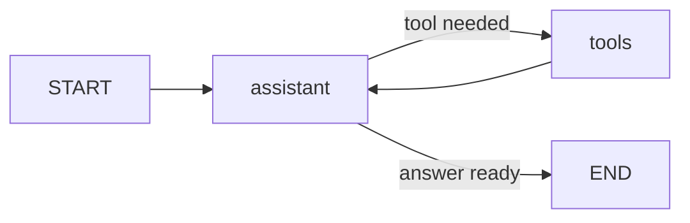

# 🗓️ Content Planner Agent

**Content Planner Agent** helps a brand plan social media posts from idea to calendar reminder.

The user shares the brand book and brand platform once; the agent saves them (`brand.json`) and remembers them in every session. When asked for a post idea, it checks upcoming public holidays in Georgia (Nager.Date API) and suitable historical events for those dates (Wikipedia "On this day"), gives a short review and asks whether to connect the idea to one of the dates. If no holiday is coming, it builds the idea on the brand alone. It then writes the content idea, a caption draft, hashtags and a visual brief for the designer. The user gives the final caption, visual link, date and time; the agent saves the post and, **only after the user's approval**, creates a Google Calendar event with all the materials. Deleting a post also needs approval.

**Who it helps:** social media managers, small business owners and content creators who find it hard to plan posts and publish on time.

Built with **LangGraph (StateGraph)** and **Groq** (`openai/gpt-oss-120b`) in Google Colab. BTU course project (Practical Assistant Agent).

---

## External services

| Service | Used for | Auth |
|---------|----------|------|
| **Nager.Date** | Public holidays in Georgia | none |
| **Wikipedia "On this day"** | Historical events for a date | none |
| **Google Calendar** (via Google Apps Script web app) | Create / delete reminder events | secret token |

## Tools

| Tool | What it does | Approval |
|------|--------------|----------|
| `save_brand` | Saves the brand profile to `brand.json` | – |
| `get_brand` | Reads the saved brand profile | – |
| `get_upcoming_holidays` | Public holidays in Georgia in the next N days (Nager.Date) | – |
| `get_on_this_day` | Up to 5 positive or neutral historical events for a date (Wikipedia), as "YEAR: text"; wars, disasters, scandals and politics are filtered out | – |
| `save_post` | Saves a planned post to `posts.json` (checks date/time format) | – |
| `list_posts` | Shows the content plan | – |
| `create_calendar_reminder` | Creates a Google Calendar event with the post materials | **yes** |
| `delete_post` | Deletes a post and its Calendar event | **yes** |

## Agent graph



- **State:** `messages`, added to the history with `add_messages` (not replaced).
- **Decision:** `tools_condition`: if the model requests a tool → `tools`, otherwise the turn ends.

## Memory

- **Conversation memory:** `InMemorySaver` checkpointer + `thread_id`. A new `thread_id` starts an empty conversation. Lost when the session ends.
- **Brand and posts memory:** `brand.json` and `posts.json` (Google Drive `MyDrive/content_planner` in Colab, `data/` folder locally). Survive between sessions.

## Approval flow

`interrupt()` is placed inside the tool, **before** the action. The agent stops and shows exactly what it is about to do; the user answers with `Command(resume=True)` or `Command(resume=False)`.

| Action | Yes | No |
|--------|-----|----|
| Create Calendar event | event created, `event_id` saved to the post | nothing created, post stays |
| Delete post | post (and its Calendar event) deleted | nothing changes |

---

## Setup

### 1. Groq API key
Create a free key at <https://console.groq.com/keys>.

### 2. Google Calendar (Apps Script)
1. <https://script.google.com> → **New project** → paste `apps_script.gs`.
2. Change `SECRET` to your own password → **Save**.
3. **Deploy → New deployment → Web app**: Execute as **Me**, Who has access **Anyone** → **Deploy** → authorize.
4. Copy the **Web app URL** (ends with `/exec`).

### 3a. Run in Google Colab
1. Open `agent.ipynb` in Colab.
2. 🔑 **Secrets**: add `GROQ_API_KEY`, `CALENDAR_URL`, `CALENDAR_TOKEN` (the SECRET from step 2) and turn on **Notebook access**.
3. **Runtime → Run all**. Allow Google Drive access when asked.
4. The tests create one real Google Calendar event and delete it again (tests 7–9).

### 3b. Run locally
```bash
pip install -r requirements.txt
cp .env.example .env        # then fill in your values
python main.py              # terminal (CLI) version
```

Streamlit: create `.streamlit/secrets.toml` (it is in `.gitignore`):
```toml
GROQ_API_KEY = "..."
CALENDAR_URL = "https://script.google.com/macros/s/.../exec"
CALENDAR_TOKEN = "..."
```
then:
```bash
streamlit run app.py
```

## Files

| File | Purpose |
|------|---------|
| `agent.ipynb` | Colab notebook: description, tools, graph diagram, tests with trajectories, evaluation table |
| `agent.py` | Shared agent code (`build_graph()`), used by Streamlit and CLI |
| `app.py` | Streamlit chat page with approve / deny buttons |
| `main.py` | Terminal (CLI) version |
| `apps_script.gs` | Google Apps Script for creating / deleting Calendar events |
| `requirements.txt` | Python libraries, one per line |
| `.env.example` | Template for local secrets (empty values) |
| `.gitignore` | Files that must not be uploaded (`.env`, `secrets.toml`, `data/`) |

## Tests

Each test is in its own notebook cell with the full trajectory (`pretty_print`) and an automatic PASS/FAIL check. The evaluation table with the results of the last run is at the end of `agent.ipynb`.

| # | Query | Expected |
|---|-------|----------|
| 1 | Brand book text | `save_brand` called, `brand.json` saved |
| 2 | New conversation: "რა იცი ჩემს ბრენდზე?" | `get_brand` reads the brand from the file (memory between sessions) |
| 3 | "პოსტის იდეა მჭირდება" | `get_brand` → `get_upcoming_holidays` → date review + question, no idea yet |
| 4 | "კი, უახლოეს თარიღს დაუკავშირე…" | idea, caption, hashtags, visual brief (conversation memory) |
| 5 | Final caption, link, time | `save_post`, one new post in `posts.json` |
| 6 | Memory: same thread vs new thread | same thread remembers the time; new thread does not know the conversation |
| 7 | "შექმენი Google Calendar-ის შეხსენება" → **yes** | event created, `event_id` saved |
| 8 | "წაშალე ეს პოსტი" → **no** | `posts.json` unchanged |
| 9 | "წაშალე ეს პოსტი" → **yes** | post and Calendar event deleted |
| 10 | "წაშალე პოსტი #999" | "not found", no approval question, nothing changed |

## Limitations

- **Georgian language quality:** the model sometimes makes grammar mistakes and mixes in letters or words from other languages. The final caption must be checked by a person.
- **Non-deterministic behaviour:** the same request sometimes skips a tool (e.g. `get_brand`). The system prompt is strict, but this can still happen; results can differ between runs.
- **Wikipedia "On this day"** returns global events and few Georgian ones; events are kept only if they contain a positive word and no negative word; this keyword filter is simple and can still miss some cases or remove good events.
- The agent checks only the **next 30 days** of holidays, Georgia only.
- The agent **does not publish** to Instagram / Facebook and **does not create visuals**; it writes a brief and stores the link to the final visual.
- Images and videos reach the Calendar event as **links**, not files.
- Conversation memory (`InMemorySaver`) is lost when the session ends; brand and posts are kept in files.
- **Groq free tier** has rate limits (error 429): wait and retry.
- The Apps Script URL and secret give access to add/delete events in the calendar: keep them only in Secrets / `.env`.
- The model `llama-3.3-70b-versatile` from the course guide was deprecated by Groq, so `openai/gpt-oss-120b` is used.
